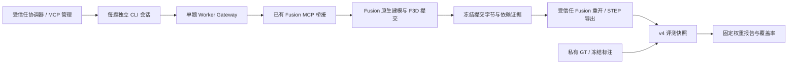

# 架构

## 管理与执行

`fusion_pipeline/service.py` 提供 stdio MCP 的 `capabilities`、`preflight`、`start_run`、`status`、`cancel`、`results`。连接配置由 `discovery.py` 安全合并，宿主技能由接收方按宿主机制安装。MCP 发现不会自动创建宿主原生子代理；`adapters.py` 负责以已配置模型启动新的 OpenCode、Codex 或 Claude Code CLI 进程。

`runner.py` 创建新 run、记录源码与输入身份、准备逐题工作区，并串行占用 Fusion 桌面。候选只接收本题冻结公开清单中的任务和有序 DXF/PNG/JPEG、通用建模说明和提交路径，旧 TASK/DXF 自动映射。`input_assets.py` 统一校验路径、格式、大小与哈希；`worker_gateway.py` 公开 `list_inputs/read_image` 原生图片读取及原有文本/DXF、Fusion schema 查询/调用、报告与提交工具；它记录哈希链日志及 `mcp_tools_scope` 调用预算，提交后撤销后续工具调用。历史scheduler外层schema 2保持，旧inputs字节不迁移；新inputs使用独立版本化合同。

`visual-check` 是显式调用模型的独立验收，使用正式Gateway读取两张随机图、识别内容并保留输入/返回图哈希和回答。它不调用Fusion；管理 `preflight` 仍只检查本地配置与CLI，不宣称模型视觉支持。`run --preflight-only` 保留原真实模型+Fusion只读连通性检查。

## 冻结与可信导出

候选提交 `submission.f3d`。调度器冻结字节、检查公开输入身份和依赖证据；维护端使用 `fusion_scripts.py` 在 Fusion 中独立重开归档，检查设计和实体健康状况，再导出 STEP。候选自行写出的 STEP 只属于候选材料，不会凭文件名获得可信导出身份。

Fusion MCP 请求超时、取消或执行状态未知时，保留锁及请求证据，停止继续建模；结束 CLI 进程不证明 Fusion 后台操作停止。恢复需要操作员确认当前桌面与请求状态，不能盲目重发同一尝试。

## v3 评分

`evaluate.py` 校验输入及哈希，保存评测快照；`worker.py` 调用 `src/metrics.py` 与 `src/robust_metrics.py`。validation 通过后按六项固定权重聚合，测量失败保留 `measured_score=null`，以 `awarded_score=0` 计入政策下界并给出覆盖率和可能得分范围。具体含义见[评分合同](SCORING_V3.md)。

本仓库包含与独立[评测器仓库](https://github.com/espresso205/fusion-step-evaluator)相应的核心，用于单包部署；流水线不要求在运行时从 GitHub 下载源码。评分核心发布身份见[文件清单](../SCORING_SOURCE_MANIFEST.json)。

## 权限与产物

管理 MCP 拥有私有配置和评分访问权，不能交给候选会话。Worker Gateway 的输入边界和严格工具选项不是操作系统沙箱；Fusion 中的任意脚本仍以桌面用户身份运行。需要强 GT 隔离时，组织者须采用不同身份或虚拟机与受限桥接服务。

直接 CLI `run` 返回运行目录，进度和结果位于该目录及维护端私有输出目录。MCP `start_run` 另返回服务 job ID，`status/results/cancel` 使用此 ID。始终同时检查逐题终态、可信导出证据、评分覆盖和失败原因；`rank_eligible` / `ranking_eligible` 保持 false。

## v4 默认评分

当前默认 v4/geometry 使用 evaluate_v4.py / worker_v4.py：原候选准入后生成刚体对齐副本，shape/dimension/mass 计主分；distance/face_match/section 与坐标偏差另作诊断。只有主分缺测降低覆盖。显式 strict 保持世界坐标，旧 v3 仍按前节合同执行。详见 [v4 合同](SCORING_V4.md)。
